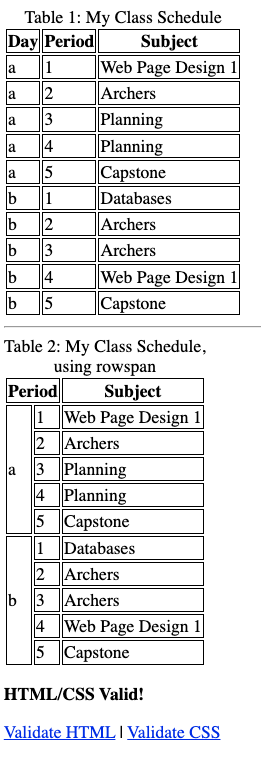

<!-- competencies: V69 N27 N28 N29 W2.8 -->

# Class Schedule Table

## Assignment Purpose

Practice building HTML tables, including cells that span multiple rows or columns.

## Requirements

Make a new HTML page called `practice/schedule.html` that shows your class
schedule. Here is an example of what it should look like:

Hint: your goal is to produce "Table 2", but I recommend starting with "Table 1"
and then modifying it.

Be sure to include your validator and use the correct filename.

As always, there is no expectation that you publish any information that you
aren't comfortable sharing with the world. If you aren't comfortable sharing this
information, you can copy mine!

## Submission

Commit and push `practice/schedule.html`. Check that DUCK can see it:
<https://duck.apscs.org/file_list?path=practice/schedule.html>

## Grading

Classwork grade. The page must be valid for full credit.
