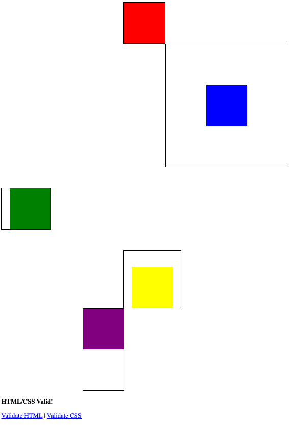

<!-- competencies: V2 V47 W4.9 W4.10 -->

# Box Model Challenge

## Assignment Purpose

Practice using the box model (content, padding, border, margin) to control
exactly how much space elements take up on the page.

## Requirements

Recreate this image:

We'll do the first box together in class, and then you'll do the rest on your own.

A few hints:

- The content of each box is 100px/100px
- Each box has `background-clip:content-box;` (which stops the color from
  showing up in the padding).
- Each box has `border:2px solid;`

If you need more review, here is a good resource:
<https://www.w3schools.com/Css/css_boxmodel.asp>

## Submission

Commit this page to `practice/box_model.html`. Check that DUCK can see it:
<https://duck.apscs.org/file_list?path=practice/box_model.html>

## Grading

Classwork grade.
