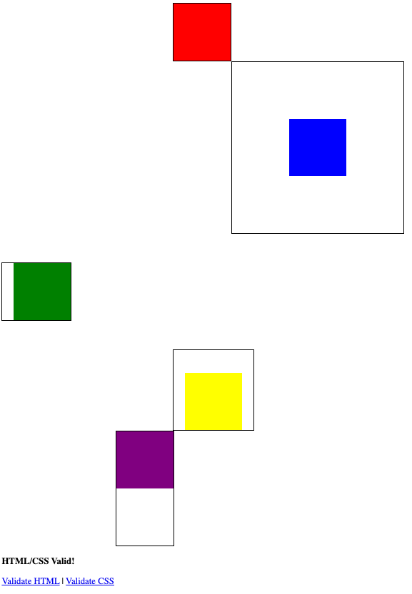

## Lesson Objectives

By the end of this lesson, you should:
- Feel confident using the box model to manipulate layouts on the page
- Understand the `
` element in HTML
- Know how to use the css flex layout

## What We'll Do In Class

### Box Model Practice

For today's practice, try to recreate this image:

We'll do the first box together, and then I'll let you play with the rest
on your own.

A few hints:
- The content of each box is 100px/100px
- Each box has `background-clip:content-box;` (which stops the color from
showing up on in the padding).
- Each box has `border:2px solid;`

If you need more review, here is a good resource: <https://www.w3schools.com/Css/css_boxmodel.asp>

In your repo, commit this page to: `practice/box_model.html`. This is
a graded classwork assignment, due Friday at 8am. Here is a 
link you can use to confirm that DUCK will see it: <https://duck.apscs.org/file_list?path=practice/box_model.html>

### Flex

Notice in the exercise above that these block elements are all still on their own line. Next, we're finally ready to start putting two things 
next to each other on the same line.

The trick to do this is the [flexible box layout](https://developer.mozilla.org/en-US/docs/Web/CSS/Guides/Flexible_box_layout) ("flexbox" or just "flex"). 

To introduce and practice with flex, we'll play with 
[Flexbox Froggy](https://flexboxfroggy.com/). Spend 
the remainder of class time playing this game. You can stop at level 13.